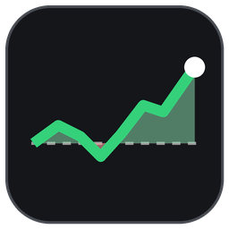
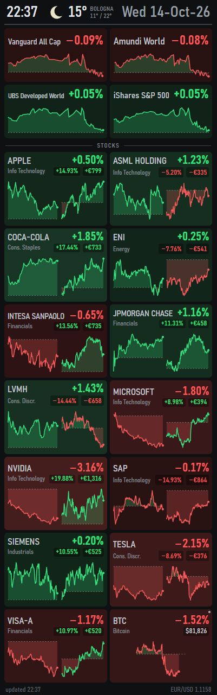

#  stockpanel

A live stock-portfolio dashboard for one of those long 400×1280 mini-monitors, on Windows.
You list your stocks with their purchase prices in a CSV file; stockpanel fetches the quotes
from Yahoo Finance every minute and shows, at a glance, how each one is doing today and how
it is doing against what you paid for it, with a chart of the day for each. It is the sibling of
[paxpanel](https://github.com/federicogiorgi/paxpanel), the hardware sensor panel, and like it
fills the little screen edge to edge, or runs as a normal window when the mini-monitor isn't
connected. It shows:

- **Date, time and the weather in Bologna** (Open-Meteo: icon, temperature, today's min/max)
- **The four indices/funds** of `list_others.csv`: daily change and today's chart, in taller
  tiles set apart from the stocks
- **Every stock** of `list_stocks.csv`: name and daily change (large), sector, result
  against the purchase price (%), the price in its own currency (London stocks in pence, as
  brokers quote them) and today's chart
- Spare cells at the end of the stock grid show Bitcoin in dollars (since midnight UTC), then USD/EUR

<p align="center"></p>
<p align="center"><sub>The example portfolio of <code>list_stocks.example.csv</code></sub></p>

Each tile is green when the stock is up for the day and red when it is down, darker or
brighter with the size of the move. The daily % uses the same colour; the result against
the purchase price has its own green/red (on a dark pill), independent of the day. In the
charts the area above the dashed reference line (the previous close) is
green and the area below it red. Quotes come from Yahoo Finance every minute.

When a stock's or fund's market is **closed**, its tile is greyed out: neutral grey under fine
hatching, with only a thin green or red edge on the left for the day's direction. Its chart
fades and is labelled **CLOSED**, or **OPENS 15:30** (**OPENS MON 09:00**) when the next session
is known; on short tiles (long lists) the label takes the sector's place. Names and numbers stay as
readable as ever. After a market closes its tile keeps the day's change until midnight; from
midnight until the market opens again (and over the weekend) there is no daily change yet, so the
daily % and the green/red edge are left out and only the price and the result against the
purchase price remain. Open markets keep the full colour and a small
white dot in the corner; the switch happens on the clock, the moment a market opens or closes.
Bitcoin and currencies trade around the clock and are always open. Just after an open, until
Yahoo's (delayed) first quotes of the day arrive, the day's change reads 0.00%.

## Requirements

- Windows 10/11 x64
- [.NET 8 Desktop Runtime](https://dotnet.microsoft.com/download/dotnet/8.0) (the SDK to build)
- [Microsoft Edge WebView2 Runtime](https://developer.microsoft.com/microsoft-edge/webview2/) (built into Windows 11)

## Build and run

```powershell
.\scripts\build.ps1            # builds StockPanel.exe here; add -NoShortcut to skip the desktop shortcut
Copy-Item list_stocks.example.csv list_stocks.csv   # then put your own stocks in it
```

Until `list_stocks.csv` exists, the panel shows the example portfolio (and says so at the
bottom). Your `list_stocks.csv` is ignored by git, so it never ends up in the repository.

Double-click `StockPanel.exe`. It must stay in this folder, next to `config.json`, the two
lists and `web\`. Right-click the panel for **Refresh now**, **Edit stocks list**, **Edit
indices list**, **Open folder**, **Save screenshot…** and **Exit**.

The last numbers are kept in `%LOCALAPPDATA%\stockpanel\last.json` and shown at start-up
(footer in amber) until fresh quotes arrive. The log is `stockpanel.log` in the same folder.

### Start with Windows

Like paxpanel, stockpanel adds itself to **Settings → Apps → Startup** as "stockpanel" the
first time it runs, **switched off**; flip the switch there whenever you want it to start at
logon. It needs no administrator rights, so the entry (a value in
`HKCU\Software\Microsoft\Windows\CurrentVersion\Run`) starts it directly, and every start keeps
it pointing at the exe if you move the folder. `StockPanel.exe --remove-startup` removes it.

Switches: `--windowed` (always a normal window), `--remove-startup` (see above), `--screenshot out.png` (save a picture of
the panel once the live data is in, then exit).

## The lists

Edit them with any editor or Excel; the panel reloads by itself a moment after you save.
Comma or semicolon separated (Excel with Italian settings: `;` and decimal commas) both work.

**`list_stocks.csv`**: the columns are found by name. Needed: a name (`Stock Name`), a ticker
and/or `ISIN`, `Purchase Price` and `Currency`; the quantity comes from a `Quantity` column,
or, as in the broker export, from `Current Total Value (Original Currency)` ÷ `Current Price`.
`Sector` and `Market` are optional.

`Purchase Price` is in the stock's own currency unless you say otherwise. Brokers often report
what you paid in euro: set `"purchaseCurrency": "EUR"` in `config.json` (as shipped), or name
the currency in the column, as in `Purchase Price (EUR)` (the column name wins). A stock bought in
another currency can say so in an optional `Purchase Currency` column (for example `GBP`, or
`GBX` for a price in pence); a filled cell wins for its own row, empty cells follow the rest. A dollar
stock's result is then its price converted at today's rate against the euro you paid, so it
includes the dollar's move since you bought. € amounts use today's exchange rates.

**`list_others.csv`**: `Name`, `Short name` (shown on the panel), `ISIN` (or `Ticker`).

### Yahoo symbols

The broker's tickers are converted to Yahoo's: `AAPL.O`/`KO.N` → `AAPL`/`KO`,
`MC.EQ` → `MC.PA` (Equiduct: the exchange of the ISIN's country), `SIE.FRA` with market
XETRA → `SIE.DE`. Otherwise the ISIN is searched on Yahoo, preferring a listing in the
list's currency. The symbol found is logged and remembered in
`%LOCALAPPDATA%\stockpanel\symbols.json`.

If one is wrong, set it in `config.json` → `symbols` (by ISIN, ticker or name), or add a
`Yahoo` column to the list. The four funds are set there already, as Yahoo's search finds
only thin or non-euro listings for some of them.

## Configure

`config.json` (reloaded automatically when saved):

| Key | What it does |
|---|---|
| `refreshSeconds` | Seconds between quote updates (default 60, at least 15) |
| `baseCurrency` | Currency of the € amounts |
| `purchaseCurrency` | Currency of the purchase prices in the stocks list (`EUR`), or `null` for each stock's own currency |
| `stocksFile`, `othersFile` | The two lists |
| `sortBy` | Tile order: `file`, `name`, `daily`, `overall`, `value` |
| `monitor` | Target screen: by size (`width`×`height`) or by `deviceName` such as `\.\DISPLAY4` |
| `weather` | Place name and coordinates |
| `symbols` | Yahoo symbol for an ISIN, ticker or name |

paxpanel looks for the same 400×1280 screen by default; to run both, give each its own
monitor with `deviceName`.

To restyle the page without the app, copy `%LOCALAPPDATA%\stockpanel\last.json` to
`web\mock.json`, serve the `web` folder and open `index.html?mock`.

## Notes

Yahoo Finance's API is unofficial and can change or rate-limit; when it is unreachable the
panel keeps the last numbers, dims the tiles and says so at the bottom. Not investment advice.

## License

MIT, see [LICENSE](LICENSE).
